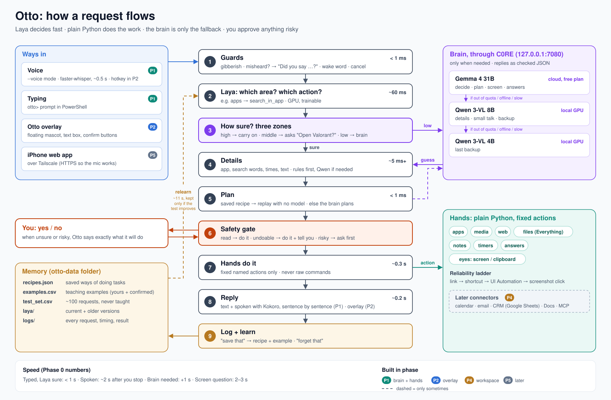
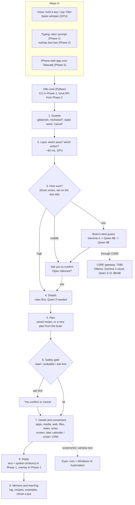

# Otto: Architecture

*Version 2, 10 November 2026. Written after Phase 0; updated with the decisions made since (three confidence zones, misheard-word checks, Kokoro voice replies, Chrome, Python 3.12). Nothing in Phase 1 onward is built yet.*

Otto is a private desktop assistant that lives on Ki Hurn's Windows PC (later the Mac and iPhone too). You talk or type to it. It decides what you want in a fraction of a second, does it with reliable code, and only calls a large language model when something has to be understood, written or looked at. It learns your way of doing things when you say **"Otto, save that"**.

This document describes the whole system. Each part is tagged with the phase that builds it.

---

## 1. Core ideas

These ideas shape every decision below.

1. **Decide fast, act reliably.** Laya (a small decision model) picks *what* you want in about 60 ms. Plain Python code does the work. A language model is never trusted to produce raw commands. *(This is the lesson from the Hermes tests: 8B models get confused by many tools, refuse to touch the desktop, and can't chain steps.)*
2. **The big brain is the fallback, not the engine.** Gemma 4 (cloud) and Qwen (local) are only called to pull details out of messy sentences, to write text, to answer questions, to read the screen, or when Laya isn't sure.
3. **A short list of options at every step.** Laya picks from about 11–14 areas, then from a handful of actions inside that area. No step ever offers it more than about 20 choices.
4. **You stay in charge.** Anything destructive or anything that leaves your computer (delete, send, pay, submit) always asks first. Otto's core code enforces this, not just the screen.
5. **It learns from you, and only becomes "smarter" if a test proves it.** Saved recipes and examples teach it. A fixed test set that is never used for teaching decides whether a new version is better.
6. **Every part can be swapped.** The brain, the speech model, the interface and even Laya sit behind simple boundaries, so one can change without rewriting the rest.
7. **Private and mostly free.** Everything runs on your PC through C0RE, except Gemma 4 cloud (free plan) and Ollama web search. You've agreed your own data may go to those.

---

## 2. The big picture



*(The Mermaid version below shows the same flow.)*



The same flow as plain text:

```text
you speak/type
   -> guards (gibberish? misheard? cancel?)   "Did you say ...?"
   -> Laya: area + action                     (fast, local)
   -> how sure?  high   -> carry on
                 middle -> "Open Valorant?"   (you: "yeah")
                 low    -> brain guesses, then asks you the same way
   -> details: app, query, time, text         (rules first, Qwen if needed)
   -> plan: saved recipe or new plan
   -> safety gate: ask you if risky
   -> Hands do it                             (plain Python, no guessing)
   -> reply in text and voice                 (Kokoro, sentence by sentence)
   -> log it; "save that" -> recipe + teaching example
```

---

## 3. The parts

| Part | Job | Built with | Phase |
|---|---|---|---|
| **Ears** | Turn speech into text, with a confidence score per sentence | faster-whisper large-v3-turbo, GPU, int8 (~0.5 s per sentence), hotword "Otto" | 1 (`--voice`) |
| **Guards** | Catch gibberish, possible mishearing, "cancel / stop"; strip the wake word ("Otto" / "auto") | wordfreq, Whisper confidence, fuzzy app-name match, simple rules | 1 |
| **Router** | Decide area and action | Laya trainable engine (`laya.load(vegaml=True)`), GPU | 1 |
| **Confidence zones** | High: act. Middle: ask you to confirm. Low: brain's best guess, then ask | Two bars, set on the test set | 1 |
| **Clarifier** | Asks one short question, understands short replies ("yeah", "nah", "Lo-fi beats"), remembers it for ~30 s | Conversation state in the core | 1 |
| **Voice out** | Speaks Otto's replies, sentence by sentence; ignores the mic while speaking | Kokoro (82M, Apache 2.0); VoiceStudio optional later for a custom voice | 1 (`--voice`) |
| **Details** | Pull out the app, search words, times, numbers, note text | Rules and lookups first; Qwen 8B returning JSON | 1 |
| **Brain** | Understand hard requests, plan new tasks, write, answer, read the screen | C0RE → Gemma 4 cloud → Qwen 3-VL 8B → 4B | 1 |
| **Recipes** | Remembered ways of doing tasks, replayed without any model | JSON file | 1 |
| **Safety gate** | Sort every action into read / undoable / ask-first and enforce it | Python, in the core | 1 |
| **Hands** | Do things on Windows | `subprocess`, `os.startfile`, app links, `pywinauto`, media keys, `pycaw`, Everything (`es.exe`) | 1 |
| **Eyes** | See what's on screen | `mss` screenshots, Windows UI Automation text, clipboard | 1 (basic), 3 (pointing) |
| **Memory** | Logs, examples, test set, recipes, settings | Files in the `otto-data` folder | 1 |
| **Learning loop** | Turn your confirmations into a better Laya, safely | Laya `fit()`, the test set, rules for switching to a new version | 1, improved in each phase |
| **Local API** | Lets the overlay (and later the iPhone) talk to the core | FastAPI on `127.0.0.1`, secret token | 2 |
| **Body (overlay)** | The floating Otto mascot, text box, confirm buttons, hotkeys | Tauri 2 (Rust + HTML/JS) | 2 |
| **Workspace connectors** | Calendar, email, CRM (Google Sheets), proposals (Google Docs) | Google APIs; also offered as an MCP server | 4 |

---

## 4. One request, step by step

Example: **"Otto, open Spotify and search lofi beats"** (spoken).

| Step | What happens | Typical time |
|---|---|---|
| Ears | You stop talking; Otto waits 0.8 s to be sure, then Whisper writes it down | 0.8 s + 0.5 s |
| Guards | Real words, so not gibberish. "Otto," at the start is the wake word and gets removed | < 1 ms |
| Router | Laya: area `apps` (91%), then action `search_in_app` (88%) | ~120 ms (two questions) |
| Gate | Both above our bar, so no brain needed | – |
| Details | App: "Spotify" matched against your installed apps. Search words: rule "search (for) X" → `lofi beats` | ~5 ms |
| Plan | Recipe found: `spotify` + `search_in_app` → open link `spotify:search:{query}` | < 1 ms |
| Safety | Opening an app is *undoable*, so do it and say so | – |
| Hands | `os.startfile("spotify:search:lofi%20beats")` | ~0.3 s for Spotify to show |
| Reply | "Searching Spotify for lofi beats." shown and spoken (Kokoro starts on the first sentence) | ~0.2 s to start speaking |
| Memory | One line added to today's log | – |

**Total from the end of your sentence: about 2 seconds, with no language model involved.**

When Laya is only fairly sure (say "Otto, Valorant"), Otto asks **"Open Valorant?"** and waits for a short answer. When it's unsure (say "chuck on some chill music"), the brain makes a best guess first (about 1 second with Gemma), and Otto asks about that guess the same way. Every confirmed answer becomes a teaching example, so next time Laya handles it alone.

---

## 5. Decision layer (Laya)

### 5.1 Two small questions, not one big one
1. **Area** (11 now, about 14 later): `apps, media, web, files, notes, timer, question, screen, memory, chitchat, unsure`. Later: `calendar, email, clients`.
2. **Action inside that area.** Each area has its own short list:

| Area | Actions |
|---|---|
| apps | open, switch_to, minimise, close, search_in_app, click_button, other |
| media | play_pause, next, previous, volume_up, volume_down, set_volume, mute |
| web | open_site, web_search |
| files | find, open |
| notes | new_note, add_to_note |
| timer | set_timer, set_alarm, remind, time_left, cancel |
| question | time_date, maths, fact_lookup, general |
| screen | describe, explain, summarise, translate, read_clipboard |
| memory | save_last, forget_last |
| chitchat | (reply only) |
| unsure | (ask you to rephrase, or say it can't do that yet) |

**In Phase 1, Laya picks only the area.** The action inside it comes from simple rules first, then Qwen. Every confirmation is logged with its action, so once there are enough action-labelled examples Laya can take over the action question too (it can answer several questions in one pass).

### 5.2 Guards before Laya
- **Gibberish:** if not one word is a real word (wordfreq), Laya isn't asked. Otto says "Sorry, I didn't catch that."
- **Wake word:** "Otto", or Whisper's "auto", at the start is removed.
- **Cancel words:** "stop", "cancel", "never mind" during a confirmation cancel it straight away.
- **Misheard?** If Whisper's own confidence in a sentence is low, Otto asks "Did you say '…'?" before doing anything. If a word is close to, but not exactly, an installed app's name ("valor and"), Otto asks "Did you mean Valorant?".
- **Junk words around a real request** ("dad awdafd open spotify") are fine: Laya and the details step look past them.

### 5.3 Confidence: three zones, our own bars
Phase 0 showed that Laya's built-in "safe to act" (AUTO) signal becomes overconfident as it learns: by 22 examples per area it said AUTO on everything. So Otto uses Laya's **percentage** for the chosen answer, with two bars set from the **test set**:

| Zone | Rule | What Otto does |
|---|---|---|
| **High** | above the *act* bar: where Laya is right ≥ 95% of the time | Carries on (risky actions still ask) |
| **Middle** | between the bars | Asks "Open Valorant?" and waits for yes/no |
| **Low** | below the *guess* bar | The brain makes a best guess, then Otto asks about it; if nothing sensible, "What would you like me to do?" |

- Otto asks **once**. If the answer is still unclear, it says so and does nothing.
- Short replies within ~30 s are treated as answers to the question ("yeah", "nah", "close it instead", "Lo-fi beats").
- Every confirmed answer is saved as a teaching example, so the questions teach Laya exactly where it is weakest. Phrasings you've confirmed several times stop being asked about once Laya has learned them.
- Both bars are re-measured every time Laya relearns, and saved alongside it. Until the test set exists, every answer counts as "middle".

### 5.4 What Phase 0 measured (on 44 unseen requests)
| Examples per area | Right |
|---|---|
| 0 (untrained) | 32–34% |
| 8 | 75% |
| 15 | 80% |
| 22 | 89% |

It runs at about 60 ms per decision on the GPU, with 1.6 GB of graphics memory, and relearns in about 11 s on the GPU.

---

## 6. Brain layer (through C0RE)

| Job | First choice | Fallbacks | Why |
|---|---|---|---|
| Pull out details (JSON) | Qwen 3-VL 8B (local) | Gemma 4 → Qwen 4B | Qwen was faster (0.1–0.2 s) and exact in Phase 0 |
| Decide when Laya is unsure, plan new tasks | Gemma 4 31B cloud | Qwen 8B → 4B | Strongest reasoning available for free |
| Answer questions (with web search) | Gemma 4 | Qwen 8B | Gemma answered from search results in 0.6 s |
| Read the screen | Gemma 4 | Qwen 8B → 4B | All three passed the image test |
| Write longer text (notes, later proposals) | Gemma 4 | Qwen 8B | Quality |
| Small talk | Qwen 8B | Gemma 4 | Fast and local |

**Rules:**
- Every call goes through **C0RE** (`http://127.0.0.1:7080`, header `Authorization: Bearer <OTTO_C0RE_KEY>`).
- Otto moves to the next model straight away on: `rate_limited` (respecting Retry-After), quota errors (HTTP 402/429), `engine_offline`, no internet, or a timeout of a few seconds. It never waits a long time on one model.
- The brain must reply in **JSON matching a fixed shape**. Otto strips ```` ```json ```` fences, checks the shape, and asks once more if it's wrong.
- Prompts stay under C0RE's **8192-token limit**. Screen text is trimmed, and only the relevant window is sent.
- The brain never runs anything itself. It can only pick from Otto's list of named actions (section 7), using the parameters each action allows.
- The logs record which model handled each request.

DeepSeek, GLM and Kimi cloud models were dropped because they aren't on Ollama's free plan. They can be added back in settings if you buy credits.

**Why not a local 14B?** A 14B model at normal compression (~10 GB) doesn't fit next to Laya, Whisper and Windows on the 12 GB card, heavier compression loses most of its advantage, and no 14B Qwen can read images. Gemma 4 31B already handles the hard thinking. The logs record how well the local backup does; if Qwen 8B struggles, adding another model is a settings change.

---

## 7. Hands: doing things on Windows

### 7.1 The reliability ladder
Each action uses the most reliable method that works:
1. **A direct command or link:** `os.startfile`, app links like `spotify:search:...` and `ms-settings:bluetooth`, URLs.
2. **A keyboard shortcut:** Ctrl+L, Ctrl+T, media keys.
3. **Windows accessibility (UI Automation):** find a button by its name with `pywinauto` and click it.
4. **Clicking from a screenshot:** the brain looks at the screen and gives a position. This is the last resort and always says what it's about to click.

### 7.2 Named actions
Each action is a Python function with a fixed name, typed parameters, and a **risk level**. The brain and recipes can only use these.

| Action | What it does | Risk |
|---|---|---|
| `open_app(name)` | Fuzzy-match against the Start menu app list, then launch. Not installed → "Valorant isn't installed" | undoable |
| `switch_to(app)` / `minimise(app)` | Bring a window to the front, or minimise it | undoable |
| `close_app(app)` | Close a window (could lose unsaved work) | **ask first** |
| `open_link(uri)` | App links; websites open in **Chrome** | undoable |
| `search_in_app(app, query)` | Link if the app has one, else shortcut plus typing | undoable |
| `click_button(app, name)` | UI Automation click by button name | undoable* |
| `media(key)` / `set_volume(n)` | Media keys, volume through `pycaw` | undoable |
| `web_search(query)` | Opens **Chrome** on a Google search | undoable |
| `find_files(query)` | Everything command line (`es.exe`) | read |
| `open_file(path)` | Opens with the default app | undoable |
| `type_text(app, text)` | Types into Notepad (never into a password box) | undoable |
| `write_note(name, text)` | Saves a text file in `Otto Notes`, then opens it | undoable |
| `timer(set/list/cancel)` | Otto's own timers with Windows notifications | undoable |
| `screenshot()` / `window_text()` / `clipboard()` | What's on screen | read |
| `delete_file(path)` | Sends to the Recycle Bin, never permanent | **ask first** |

\* A click that would send, buy, submit or delete becomes **ask first**. Otto checks the button's name for words like Send, Buy, Pay, Submit and Delete.

### 7.3 Lookups the Hands rely on
- **App list:** built at start-up from the Start menu shortcuts and Windows' list of installed apps, then refreshed every hour.
- **Website names:** a small list ("youtube" → youtube.com), which grows from recipes.
- **Everything:** must be installed, plus its `es.exe` command-line tool.

---

## 8. Recipes: how Otto remembers a way of doing something

A recipe is a saved plan, keyed by **area + action + target**:

```json
{
  "id": "apps.search_in_app.spotify",
  "area": "apps",
  "action": "search_in_app",
  "target": "spotify",
  "params": {"query": "text"},
  "steps": [
    {"do": "open_link", "with": {"uri": "spotify:search:{query}"}}
  ],
  "risk": "undoable",
  "learned_from": "gemma4:31b-cloud",
  "created": "2026-11-12T20:14:00",
  "used": 14,
  "worked": 14
}
```

- **Using one:** after Laya and the details step, Otto looks up `area.action.target`. If a recipe exists, its steps run with no model call.
- **Making one:** when the brain plans a new task and you confirm it worked ("save that"), the plan becomes a recipe.
- **Forgetting:** "forget that" deletes the last recipe used or made.
- **Self-check:** Otto counts how often each recipe works. If one starts failing, for example after an app update, Otto stops trusting it and asks the brain again.

---

## 9. Learning loop

```text
             +-------------------- you --------------------+
             |  confirm / correct / "save that" / "forget"  |
             v                                              |
 request -> Laya -> (brain if unsure) -> action -> "did that work?"
             |                                              |
             v                                              v
    logs/YYYY-MM-DD.jsonl                     examples.csv  +  recipes.json
                                                   |
                                      relearn (Laya fit, ~11 s, in the background)
                                                   |
                          score on test_set.csv (NEVER used for teaching)
                                                   |
                   better or equal? -> switch to it, set the new confidence zones
                   worse?           -> keep the old one, tell you
```

**Where examples come from:**
1. My starter sets (242 teaching examples now, plus the 44 kept aside for testing).
2. Your corrections in `try_laya.py` and in Otto.
3. Brain decisions you confirmed worked. These are marked so they can be weighted or reviewed.

**Rules:**
- The **test set** (about 100 requests, labelled by you) is never taught. If you type one of its requests, Otto won't save it as an example.
- Relearning runs every 20 new examples, at start-up if there are new ones, or when you ask.
- Every version of Laya's learning is saved, so you can go back to an older one.

---

## 10. Safety

| Level | Examples | What Otto does |
|---|---|---|
| **Read** | find files, read the screen, the time, how long is left on a timer | Just does it |
| **Undoable** | open/switch/minimise apps, media, open sites, write a note, set a timer | Does it and tells you; "undo" where possible |
| **Ask first** | close apps, delete (to the Recycle Bin), anything that sends, buys, submits or posts, later anything to a client | Shows exactly what will happen and waits for yes or no |

- **Enforced in the core.** The safety gate sits in the executor, so no interface, recipe or brain reply can skip it.
- **Never in password boxes.** `type_text` checks UI Automation's "is password" flag and refuses.
- **Screen text is information, never instructions.** Text Otto reads from the screen, web pages or emails can't trigger actions. Only you can.
- **Panic stop:** Ctrl+C in Phase 1; a global hotkey (for example Ctrl+Shift+X) from Phase 2 stops everything and cancels timers in progress.
- **Local API lock (Phase 2):** listens only on `127.0.0.1` and requires a random token. The overlay gets the token at start-up. Opening it to Tailscale is a separate, deliberate setting.
- **Audit log:** every action Otto takes is written to the log with time, reason and result.
- **Secrets:** read only from environment variables (`OTTO_C0RE_KEY`, `OLLAMA_API_KEY`). Never written to logs or files.

---

## 11. Data and settings

All of Otto's own data lives in one folder, `otto-data`, next to the code, so it's easy to back up or reset:

```text
otto-data/
├── settings.json        brains and fallback order, confidence zones, Whisper, voice, browser
├── recipes.json         saved ways of doing things
├── examples.csv         teaching examples (starter + yours + confirmed brain decisions)
├── test_set.csv         ~100 requests you labelled, never taught
├── sites.json           website names -> addresses ("gmail" -> mail.google.com); add your own
├── app_aliases.json     app nicknames ("vs code" -> Visual Studio Code); add your own
├── apps_cache.json      installed apps, refreshed hourly
├── laya/
│   ├── current/         Laya's active learning (heads + calibration)
│   └── history/         older versions, to roll back
├── logs/
│   └── 2026-11-12.jsonl one line per request: text, area, action, %, brain, timings, result, your feedback
└── notes/               notes Otto writes
```

`settings.json` (the defaults; yours is merged on top, so new options appear automatically):

```json
{
  "c0re_url": "http://127.0.0.1:7080",
  "brains": {
    "extract": ["qwen3-vl:8b-instruct", "gemma4:31b-cloud", "qwen3-vl:4b-instruct"],
    "decide":  ["gemma4:31b-cloud", "qwen3-vl:8b-instruct", "qwen3-vl:4b-instruct"],
    "screen":  ["gemma4:31b-cloud", "qwen3-vl:8b-instruct", "qwen3-vl:4b-instruct"],
    "answer":  ["gemma4:31b-cloud", "qwen3-vl:8b-instruct", "qwen3-vl:4b-instruct"],
    "chat":    ["qwen3-vl:8b-instruct", "gemma4:31b-cloud", "qwen3-vl:4b-instruct"]
  },
  "brain_timeout_s": 12,

  "laya": {"device": "cuda", "retrain_every": 20},
  "zones": {
    "act_bar": 0.85,
    "guess_bar": 0.40,
    "use_measured": true,
    "act_bar_floor": 0.70,
    "ask_zone_min": 0.20,
    "clarify_timeout_s": 30
  },

  "whisper": {
    "model": "large-v3-turbo",
    "device": "cuda",
    "precision": "int8_float16",
    "hotwords": "Otto",
    "end_silence_s": 0.8,
    "misheard_below": -0.9,
    "mic_device": null
  },
  "voice_out": {"engine": "kokoro", "voice": "af_bella", "device": "cuda", "speed": 1.0},

  "browser": "chrome",
  "everything_es_path": null,
  "show_details": true
}
```

`act_bar` and `guess_bar` are starting guesses. Once the test set is big enough, the bars measured on it replace them (`use_measured`), with two safety limits: Otto never acts alone below `act_bar_floor`, and the "ask you" zone is always at least `ask_zone_min` wide. (The first real test run measured an act bar of 57% from only 100 requests; that's too little evidence to be that bold.) `misheard_below` is a starting guess for Whisper's confidence, to be tuned from your logs.

---

## 12. Code layout

```text
otto/
├── otto.py                  start here: the otto> prompt; --voice, --speak, --dry-run
├── otto.cmd / tool.cmd      launchers that use Otto's private Python (.\otto.cmd, .\tool.cmd score)
├── setup.ps1, requirements.txt, README.md, .gitignore
├── docs/                    ARCHITECTURE.md (this file), architecture.svg / .png
├── defaults/                starting settings, examples, test set, sites, app nicknames (copied into otto-data once)
├── core/
│   ├── config.py            folders, settings (yours merged over the defaults), keys from environment variables
│   ├── areas.py             Laya's areas, and the actions inside each area
│   ├── pipeline.py          the request flow from section 4, start to finish, and the follow-up questions
│   ├── guards.py            gibberish, wake word, yes/no replies, cancel, "save that" / "forget that"
│   ├── router.py            Laya: area, confidence zones, relearn + test + keep-only-if-better
│   ├── details.py           action and parameters: rules first, then Qwen
│   ├── planner.py           recipe -> built-in way -> brain plan from the named actions
│   ├── safety.py            risk levels, confirmations, running plans, audit log
│   ├── brain.py             C0RE client, fallback chains, JSON checking, cool-downs after limits
│   ├── answers.py           time, date, maths locally; web search + brain for the rest
│   ├── recipes.py           load, save, forget, success counting
│   ├── learning.py          teaching examples and the test set
│   └── log.py               one line per request and per action
├── hands/
│   ├── registry.py          the named actions, their parameters and risk levels
│   ├── win.py               windows, focus, keyboard (Windows helpers)
│   ├── apps.py              installed-app list, open/switch/minimise/close, search_in_app, click_button, hotkey, type_text
│   ├── media.py             media keys, volume
│   ├── web.py               Chrome, websites, Google searches
│   ├── files.py             Everything search, open files and folders
│   ├── notes.py             notes in otto-data/notes, opened in Notepad
│   └── timers.py            timers, alarms, reminders, notifications
├── senses/
│   ├── ears.py              microphone + faster-whisper, with Whisper's confidence for "did you say...?"
│   ├── mouth.py             Kokoro voice (Bella / Michael), sentence by sentence; mutes the ears while speaking
│   ├── eyes.py              the window you were using, screenshots, clipboard
│   └── cuda_libs.py         makes the NVIDIA libraries findable for Whisper on Windows
├── tools/
│   ├── label_tests.py       check the test set's labels
│   ├── score.py             test score, zones, mistakes
│   ├── try_laya.py          teach Laya by typing, without doing anything
│   └── voice_test.py        hear Bella and Michael
├── api/, overlay/           (Phase 2) local API and the floating Otto
├── connectors/              (Phase 4) calendar, email, CRM, Docs; MCP server
└── otto-data/               section 11 (backed up by OneDrive, not committed to git)
```

---

## 13. Resources on your PC

**Graphics memory (RTX 4070 Super, 12 GB), measured in Phase 0:**

| What | Approx. |
|---|---|
| Windows desktop and apps | ~1 GB |
| Laya trainable engine | ~1.6 GB |
| Whisper large-v3-turbo (int8) | ~1 GB |
| Qwen 3-VL 8B (via Ollama, when loaded) | ~5.7 GB |
| Kokoro voice (small) | ~0.5 GB (or 0 on the processor) |
| **Total** | **~9.8 GB, leaving ~2 GB spare** |

Gemma 4 runs in the cloud and uses no graphics memory. Qwen 4B (~3.5 GB) should only be loaded when needed. Ollama unloads idle models after a few minutes.

**Speed targets:**

| Path | Target |
|---|---|
| Typed, Laya sure, recipe exists | < 1 s to start the action |
| Spoken, same | < 2.5 s from when you stop talking |
| Brain needed | + ~1 s (Gemma) |
| Screen question | ~2–3 s |

---

## 14. Interfaces over time

| Phase | How you use Otto |
|---|---|
| 1 | PowerShell `otto>` prompt. `--voice`: talk to Otto and it answers out loud (Kokoro) |
| 2 | The floating **Otto** overlay (Tauri): hold-a-key to talk, text box, confirm buttons, status. The core becomes a local API. |
| 3 | The overlay can **point** at buttons and walk you through steps (Nūs-style), and understands the screen better |
| 4 | Calendar, email and CRM in the same conversation. The same tools are also offered as an MCP server for other apps. |
| 5 | Custom Otto voice (VoiceStudio, optional). iPhone web app over Tailscale (HTTPS, so the mic works). Mac version (needs Mac-specific Hands and Eyes). |

---

## 15. Roadmap and pass marks

| Phase | Builds | Pass marks |
|---|---|---|
| **0 ✅** | Checks: C0RE models, Laya, Whisper, memory, web search | Done |
| **1: Brain + Hands** | Sections 4–12: guards (incl. misheard checks), Laya area + action, three confidence zones + clarifier, brain chains, details, recipes, safety, Hands, basic Eyes, learning loop, logs, test set, `otto>` prompt, `--voice` with Kokoro replies | When Laya acts alone it's right ≥ 95% of the time; ≥ 90% of all requests handled correctly; recipes work ≥ 95% of the time; < 1 s typed / < 2.5 s spoken |
| **2: Body** | Local API, Tauri overlay with the Otto mascot, hotkeys, hold-to-talk, panic key | Overlay round trip feels instant; confirmations work from the overlay |
| **3: Eyes** | Pointing at buttons, step-by-step guidance, better screen understanding (replaces Lenz) | Points at the right button ≥ 90% of the time on common apps |
| **4: Workspace** | Calendar, email, CRM (Google Sheets), proposals (Google Docs), MCP server | Client changes always previewed; nothing sent without a yes |
| **5: Reach** | Custom voice, iPhone web app, Mac | – |

If Phase 1 misses its pass marks after a fair amount of teaching, Otto narrows its focus to a **CRM assistant with an MCP server**, which was the original idea.

---

## 16. Open decisions

| Question | Suggested answer |
|---|---|
| Voice in Phase 1? | **Decided:** yes, `--voice`, with spoken replies (Kokoro) |
| Who writes the test set? | **Decided:** Claude drafts ~100 requests in your style; you correct the labels |
| Brains per job | **Decided:** as in section 6 |
| Apps and browser | **Decided:** Spotify desktop app is installed; Chrome for all web; uninstalled apps get "X isn't installed" |
| Local model size | **Decided:** keep Qwen 8B; revisit only if the logs show it struggling |
| Python | **Decided:** 3.12 for Otto (Kokoro and others don't support 3.14 yet) |
| Wake word | Open: hold-a-key first (Phase 2); an always-listening "Otto" wake word later, if wanted |
| Kokoro voice | Open: pick one from Kokoro's list during Phase 1 |
| Mascot design | Open: Ki Hurn designs it; the overlay will accept an image or animation |

## 17. Known risks

| Risk | What we do about it |
|---|---|
| Laya plateaus below the pass marks | More of your examples, two-step questions, our own confidence zones and asking you; the brain covers the rest. Larger Laya readers or full training are the next options. |
| Gemma's free cloud allowance runs out or changes | Automatic fallback to Qwen; everything still works locally, just a bit less clever |
| App updates break recipes or button names | Recipes track success; links and shortcuts are preferred over clicking |
| Graphics memory gets tight (games, other models) | Whisper can move to the processor; Qwen 4B only when needed |
| Clicking the wrong thing | Reliability ladder, ask-first for risky buttons, never into password boxes, audit log |
| A web page or email tries to give Otto orders | Screen text is information only; only named actions run, and risky ones need your yes |
